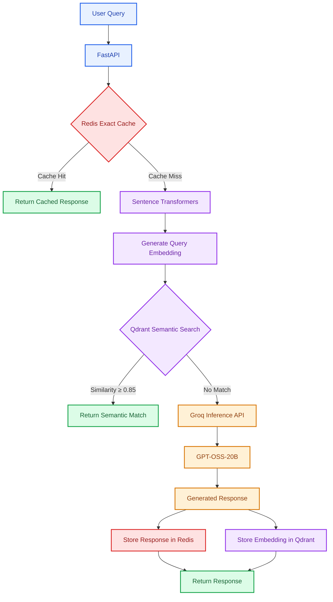

<div align="center">

# LLM Semantic Cache Engine

### A Two-Level Caching System for Efficient LLM Inference

An intelligent caching architecture that reduces redundant LLM calls through exact-match retrieval and semantic similarity search.


</div>

---

## Overview

The **LLM Semantic Cache Engine** is a Python-based caching system designed to improve response efficiency and reduce unnecessary Large Language Model (LLM) inference calls.

The system combines Redis for exact-match caching with Qdrant and Sentence Transformers for semantic similarity search. When no suitable cached response is found, Groq generates a new response using the GPT-OSS-20B model.

Generated responses are cached for subsequent requests, enabling faster retrieval without repeated model inference.

## Technology Stack

| Component       | Technology             | Purpose                       |
| --------------- | ---------------------- | ----------------------------- |
| Backend         | Python, FastAPI        | Asynchronous REST API         |
| LLM Inference   | Groq, GPT-OSS-20B      | Response generation           |
| Embeddings      | Sentence Transformers  | Semantic text representations |
| Vector Database | Qdrant                 | Similarity search             |
| Exact Cache     | Redis                  | Fast response retrieval       |
| Infrastructure  | Docker, Docker Compose | Containerized services        |
| Configuration   | Pydantic Settings      | Configuration and validation  |

## System Architecture



## Cache Decision Flow

The application processes each query through three stages:

**01 — Exact-Match Retrieval**

Redis checks for an existing response associated with the same query. If a cached entry exists, the application returns it without invoking the LLM.

**02 — Semantic Similarity Search**

If an exact match is unavailable, Sentence Transformers generates a query embedding. Qdrant searches for previously processed queries with similar semantic representations.

A cached response is returned when the similarity score meets the configured threshold.

**03 — LLM Inference**

If neither cache produces a suitable match, Groq generates a new response. The application stores the response in Redis and the query embedding in Qdrant for future retrieval.

## Getting Started

### Prerequisites

- Python 3.12
- Docker and Docker Compose
- Groq API key

### Installation

**1. Install project dependencies**

```bash
pip install -r requirements.txt
```

**2. Configure environment variables**

Copy `.env.example` to `.env` and configure:

```env
GROQ_API_KEY=your_api_key_here
DEFAULT_LLM_PROVIDER=groq
DEFAULT_MODEL=openai/gpt-oss-20b

REDIS_HOST=localhost
QDRANT_HOST=localhost
```

**3. Start the caching services**

```bash
docker compose up -d redis qdrant
```

**4. Start the API server**

```bash
python -m uvicorn app.main:app --host 127.0.0.1 --port 8000
```

**5. Access the API documentation**

Open: http://127.0.0.1:8000/docs

### Example API Request

**Endpoint:** `POST /api/v1/query`

```json
{
  "query": "Explain machine learning in simple words.",
  "provider": "groq",
  "model": "openai/gpt-oss-20b",
  "use_cache": true
}
```

## Implementation Status

| Functionality                      | Status      |
| ---------------------------------- | ----------- |
| Groq LLM integration               | Implemented |
| FastAPI query processing           | Implemented |
| Redis exact-match caching          | Verified    |
| Qdrant semantic caching            | Verified    |
| Sentence embedding generation      | Verified    |
| Automated performance benchmarking | Planned     |
| Embedding model evaluation         | Planned     |

## Future Work

- Automated latency and cache-hit benchmarking
- Comparative embedding model evaluation
- Adaptive semantic similarity thresholds
- Cache accuracy and reliability testing
